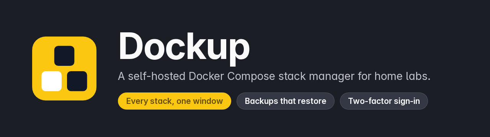
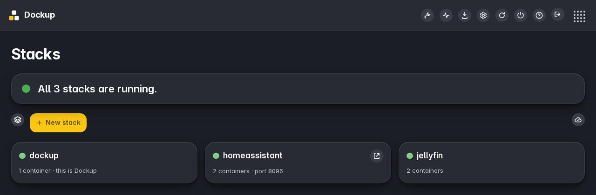
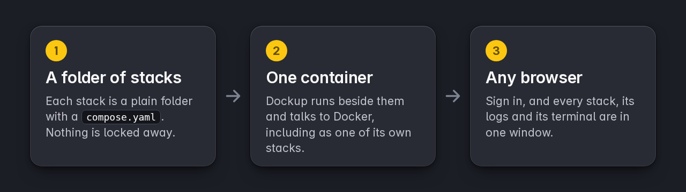
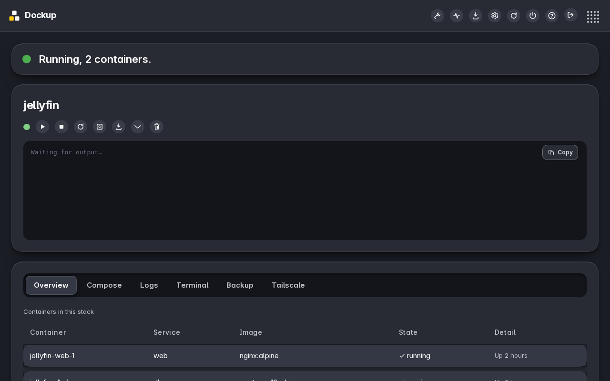
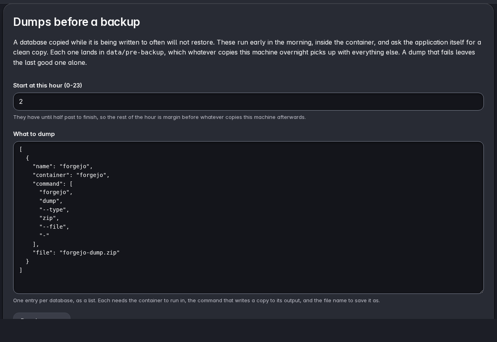
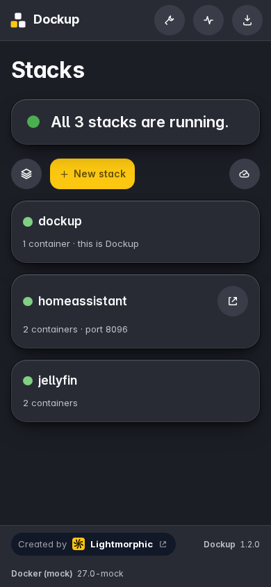

<p align="center">
  
</p>

<p align="center">
  
  
  
  
</p>

Dockup is a self-hosted manager for Docker Compose stacks. Every stack is a
plain folder with a compose file in it, so you can run, edit or back it up
with any other tool, and walk away from Dockup whenever you like without
leaving anything behind.

It gives you one window for all of them: their status, logs and a terminal,
a compose editor with live checking, updates, and backups that restore. It
is one small container, and it appears in its own list like any other stack.

> **Home labs only, for now.** Dockup is built for a machine on your own
> network, reached over Tailscale or your LAN. It is not hardened for direct
> internet exposure, so please do not put it on a public server.

<p align="center">
  
</p>

## How it works

<p align="center">
  
</p>

## Quick start

```yaml
services:
  dockup:
    image: ghcr.io/gh-lm/dockup:latest
    container_name: dockup
    restart: unless-stopped
    ports:
      - "127.0.0.1:4000:5001"
    environment:
      SECRET_KEY: ${SECRET_KEY:-CHANGE-ME-TO-YOUR-OWN-LONG-RANDOM-SECRET}
    volumes:
      - ./data:/app/data
      - /var/run/docker.sock:/var/run/docker.sock
      - /opt/stacks:/opt/stacks
```

That is the short version. The [full compose file](compose.yaml) also drops
privileges the container does not need and sets resource limits, and is the
one to use. Put Dockup in the stacks folder, so that it sits beside
everything it manages:

```bash
mkdir -p /opt/stacks/dockup && cd /opt/stacks/dockup
curl -fsSL -o compose.yaml https://raw.githubusercontent.com/gh-lm/dockup/main/compose.yaml
echo "SECRET_KEY=$(python3 -c 'import secrets;print(secrets.token_urlsafe(48))')" > .env
docker compose up -d
```

Open <http://localhost:4000> and create the admin account straight away: until
an account exists, whoever opens the page first can create it.

The secret key signs your login, so it has to be yours alone. Dockup refuses
to start while it is missing, short, or still the example value, and tells
you why in one line. It is the only setting that lives outside Dockup's own
Settings page.

To update, open Dockup in its own list and press Update, the same as for any
other stack. From a terminal it is the usual:

```bash
docker compose pull && docker compose up -d
```

The one thing a container cannot do to itself is replace its own container,
so that step is handed to a short-lived helper. The page goes quiet for a few
seconds and comes back on its own.

## Managing a stack

Open a stack to see its containers, edit its compose file, read live logs,
open a terminal inside any container, back it up, or switch Tailscale Serve
on for its ports.

<p align="center">
  
</p>

Every screen opens with one plain sentence saying how things stand. Anything
that cannot be undone asks twice: the first click fills the button, and a
second within three seconds does it.

## Backups that restore

A daily backup of Dockup's own settings and history, a per-stack backup that
includes the real data (bind-mounted folders and named volumes), and a
download of everything. A restore refuses while stacks are running, swaps
each stack folder instead of deleting it, and keeps the old one beside it.

A database copied while it is being written to often will not restore, so
Dockup can also ask an application for a clean copy of itself before whatever
copies your machine overnight. A dump that fails never replaces a good one.

<table>
<tr>
<td width="62%"></td>
<td width="38%" align="center"></td>
</tr>
<tr>
<td align="center"><b>Dumps before a backup</b></td>
<td align="center"><b>The same stacks on a phone</b></td>
</tr>
</table>

## What it does

- All your compose stacks on one dashboard, with live status
- A compose editor with live validation, and a converter from a `docker run`
  command to a compose file
- Start, stop, restart, redeploy (recreate from the compose file, without
  pulling) and update, each with its output streamed live
- Adopt what is already running, one at a time or all together, with nothing
  restarted
- Checks every thirty minutes for a newer image for each stack, and updates
  one stack or all of them on your say-so. Nothing pulls on its own
- Live logs with errors picked out, and a terminal into any running container
- Archive a stack with nothing running (its folder is kept), or delete it for
  good along with the images it used
- Clean up unused images, containers, networks and build cache, with the
  volumes that would go always shown first
- A running activity log, and optional email when something breaks
- Private registries: sign-in details entered once in Settings and stored
  encrypted
- An optional helper on the machine itself for operating system updates and
  for switching Tailscale Serve on a stack's ports, installed from Settings
- A real sign-in: a lockout after repeated failures and optional
  two-factor codes
- Dark throughout, installable from the browser, and usable on a phone

## Settings

Everything except the secret key is entered on Dockup's own Settings page.
The container itself reads a few environment variables:

| Variable | Required | Default | What it does |
|---|---|---|---|
| `SECRET_KEY` | **yes** | none | Signs your login and keys the encryption of stored secrets. At least 32 characters, and not the example value. |
| `TZ` | no | `Europe/London` | The time zone Dockup uses for its schedules. |
| `DOCKUP_DATA_HOST_PATH` | no | `/opt/stacks/dockup/data` | Where Dockup's data folder is on the machine itself. Set it if you put Dockup's folder anywhere else, because Docker resolves paths on the machine, not inside the container. |
| `DOCKUP_STACKS` | no | `/opt/stacks` | Where Dockup looks for stacks, as it sees the folder inside the container. Mount the same path from the machine. |
| `DOCKUP_DATA` | no | `/app/data` | Dockup's own data inside the container. |

## Where your data lives

Each stack is a folder in `/opt/stacks` with a `compose.yaml`, and an optional
`.env`, beside it. That is where your stacks live and the folder worth
backing up.

Dockup's own settings, accounts and history are one SQLite database in its
data folder, `/opt/stacks/dockup/data`. Its daily backups, per-stack backups
and the dumps it writes before a backup are in the same folder. Stored
secrets such as registry tokens and the email password are encrypted with a
key derived from `SECRET_KEY`, so a backup alone cannot be read without it.
Keep the key somewhere safe: without it, those settings have to be entered
again.

## Security

Built in:

- A signed session cookie that is `HttpOnly` and `SameSite`, a lockout after
  repeated failures, and optional two-factor codes
- Passwords hashed, and every other secret encrypted at rest
- A CSRF token on every request that changes something once signed in
- A Content-Security-Policy that allows scripts and styles only from Dockup
  itself
- The container runs as an ordinary user, drops the privileges it does not
  need, and is bound to the local machine only
- No analytics and no tracking. The one request that leaves is the
  Lightmorphic app launcher in the top bar; [SECURITY.md](SECURITY.md) says
  how to remove it

Dockup holds the Docker socket, which is the same as root on the machine, so
treat access to Dockup that way. Please read [SECURITY.md](SECURITY.md) for
what to expect, and how to report a problem privately.

## Building it yourself

```bash
git clone https://github.com/gh-lm/dockup.git
cd dockup
docker build -t dockup .
```

Then replace the `image:` line in your compose file with `dockup`. To work on
it without Docker, `DOCKUP_MOCK=1 python dev_run.py` starts the app on
<http://localhost:5001> with a pretend engine and made-up stacks.

```bash
pip install -r requirements.txt pytest
python -m pytest tests
```

The [runbook](runbook.md) covers the rest in plain language: restoring,
rolling back, and what to do when something is wrong.

## Licence

Copyright Lightmorphic Ltd. Dockup is free software under the **GNU General
Public License v3.0**, for every version, see [LICENSE](LICENSE). You may use,
study, change and share it; if you share a changed version, it has to carry
the same freedoms. What changed in each release is in
[CHANGELOG.md](CHANGELOG.md). To take part, read
[CONTRIBUTING.md](CONTRIBUTING.md); report security problems as set out in
[SECURITY.md](SECURITY.md).

Bundled third-party parts: [xterm.js](https://xtermjs.org) (MIT) for the
terminal and Trindle Sans (SIL Open Font Licence) for the type. Python
dependencies are listed in `requirements.txt`.

## Disclaimer

Dockup comes with no warranty of any kind. It can stop, replace and delete
containers and their data, which is the point of it. Keep your own backups
of anything you cannot afford to lose.
